<h1 align="center">WAR ROOM</h1>

<p align="center">
  <strong>Your personal command center for getting several AIs to work together.</strong><br>
  One orchestrator, a team of specialized agents, your subscriptions and API keys, on your own machine, with full visibility on what it costs.
</p>

<p align="center">
  <a href="#quick-start">Quick start</a> ·
  <a href="#why-war-room">Why</a> ·
  <a href="#a-visual-tour">Visual tour</a> ·
  <a href="#features">Features</a> ·
  <a href="docs/ARCHITECTURE.md">Architecture</a>
</p>

<p align="center">
  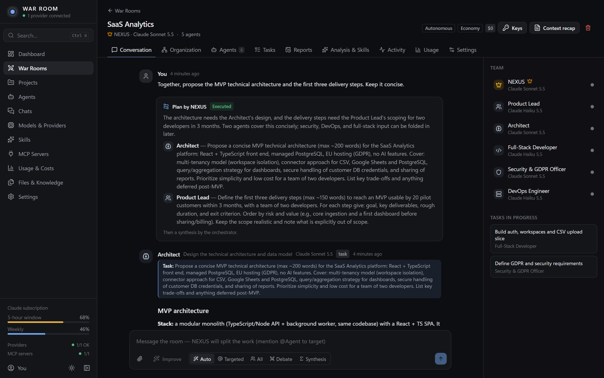
</p>

---

## Why WAR ROOM

Working seriously with AI today means juggling browser tabs, pasting the same context from one tool to another, never knowing what a conversation costs, and hitting a subscription limit in the middle of an important task.

WAR ROOM brings all of this into a single application, designed as a command center.

**A team, not just a chatbot.** You describe your project; the orchestrator analyzes it, proposes a team of specialized agents (architect, developer, security, product…), splits the work, cross-checks the answers and hands you a synthesis. Every agent really calls its own model, with its own role, memory and tools.

**Your subscriptions, finally put to work.** Your Claude Pro/Max subscription is used through the official Claude Code command, without touching any token. You can add API keys (Anthropic, OpenAI, Gemini, Mistral, DeepSeek, xAI, OpenRouter) or free local models with Ollama, and mix providers within the same team.

**Costs under control, never made up.** Every call is recorded with the exact token counts returned by the provider. Costs are labeled honestly: billed by the API, included in the subscription, local, or unknown when the price is missing. Budgets per project, War Room or agent block calls before they overrun, and the orchestrator only involves the agents that are actually needed.

**Never caught off guard by limits again.** WAR ROOM tracks your Claude usage windows (5-hour and weekly), predicts when you will hit them, pauses the work cleanly before the cutoff, then offers to resume exactly where you left off as soon as the window resets.

**Context no longer gets lost.** A complete recap of a War Room is generated in one click, ready to hand over to another AI or a colleague. A progress report is produced every day. Long histories are summarized automatically to reduce the tokens sent.

**Agents that act, under control.** Agents use tools through MCP (Model Context Protocol), with per-agent permissions, human approval for sensitive actions, and secret keys they can use without ever being able to read them.

**Fully local.** The application runs on your computer, the API only listens on `127.0.0.1`, and keys are encrypted on your disk. Your projects never go through an intermediate server.

---

## A visual tour

The interface is available in English and French (Settings, Language). Reports and recaps follow the same setting.

### An orchestrated group conversation

Write to the whole War Room. The orchestrator picks the relevant agents, gives each one a precise mission, then synthesizes their answers and settles the disagreements. You can also target one agent with `@Name`, force every agent to answer, or start a debate.

<p align="center">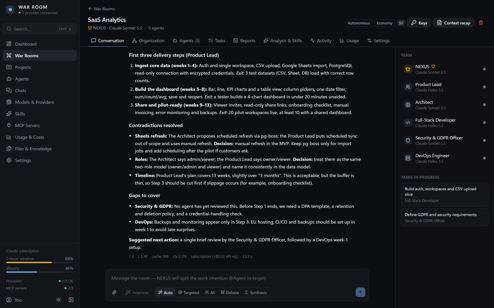</p>

### A team proposed from your brief

The orchestrator reads your brief and documents, then proposes the roles you need, the first tasks, useful Skills (checked against your actual inventory) and relevant MCP servers. Nothing is created without your approval, and each agent's model is chosen according to your cost strategy.

<p align="center">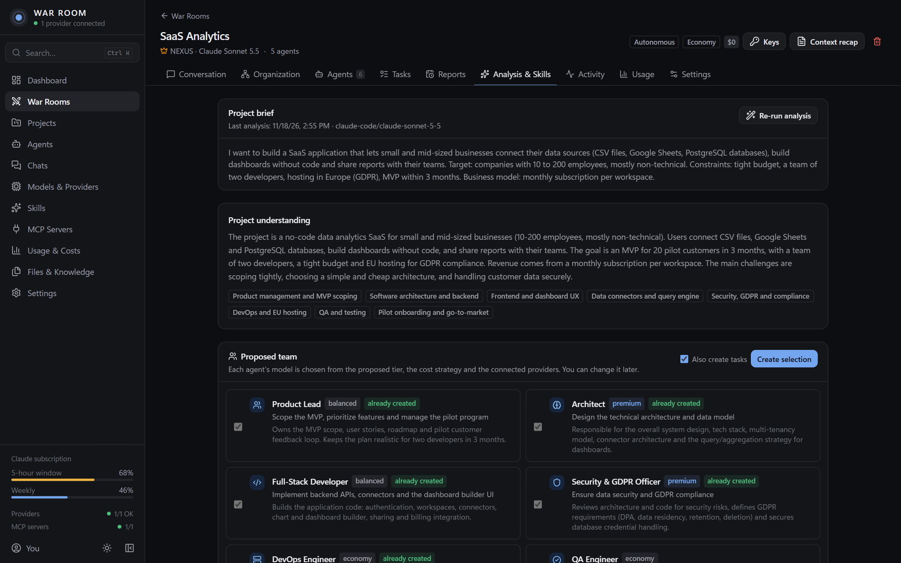</p>

### A readable organization

The orchestrator in the middle, its agents around it, with each one's model and workload. A second view shows live activity: who is working, on what, and the exchanges between agents.

<p align="center">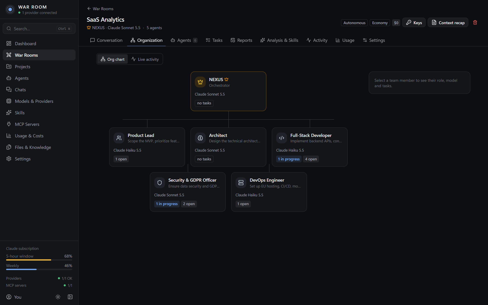</p>

### Day-to-day project tracking

Tasks are created by the analysis, by the orchestrator for each mission, or by you, and are tracked on a kanban board. Every day, a progress report sums up what was done, what is blocked and the next steps, without a single AI call.

<p align="center">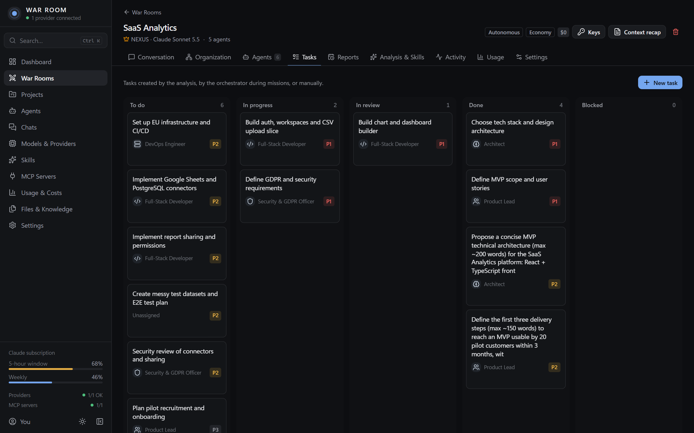 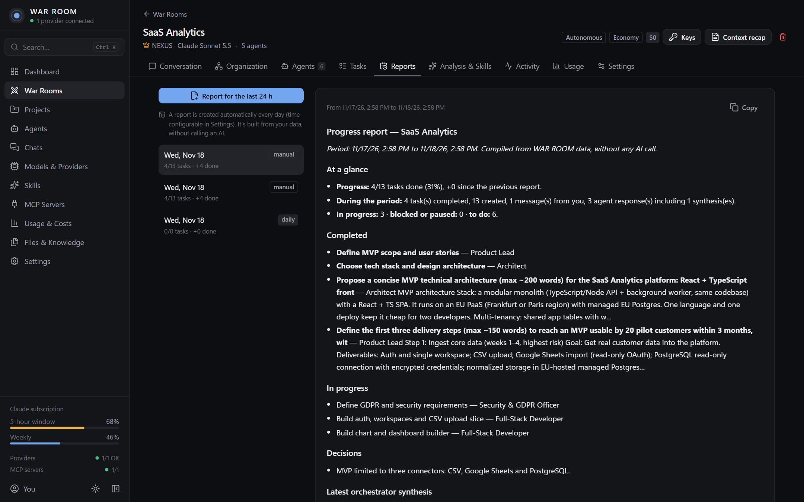</p>

### Context you can hand over to any AI

The recap gathers the objective, the brief, the decisions, the team, task status and recent exchanges. It is free, available even while Claude is paused, and can also be written by the AI of your choice.

<p align="center">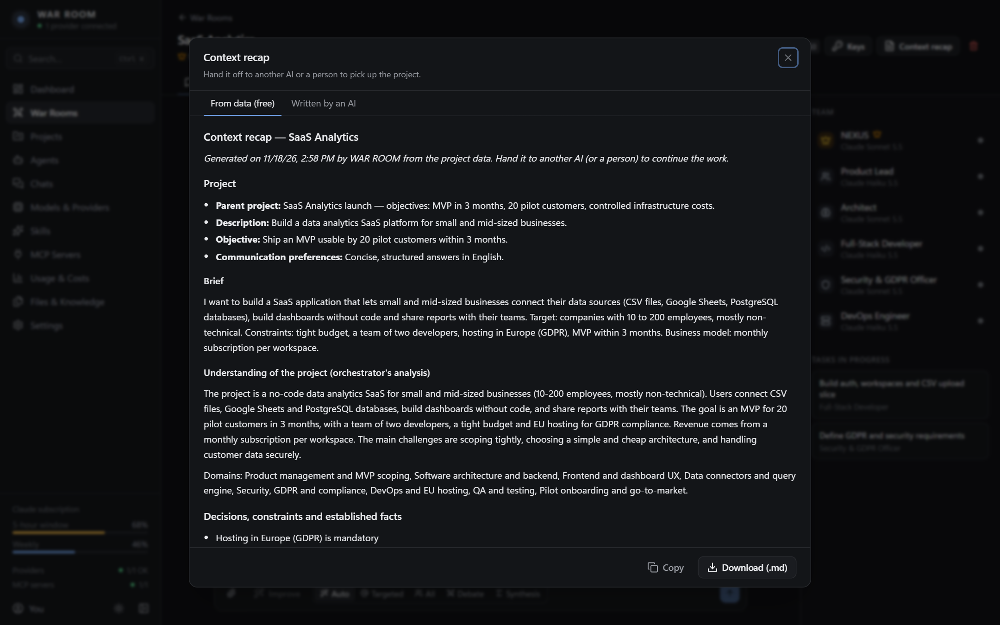</p>

### Secret keys that can be used, never read

Add an API key to a War Room: agents reference it in their tool calls, WAR ROOM inserts the value at the last moment and masks it in everything that goes back to the AI.

<p align="center">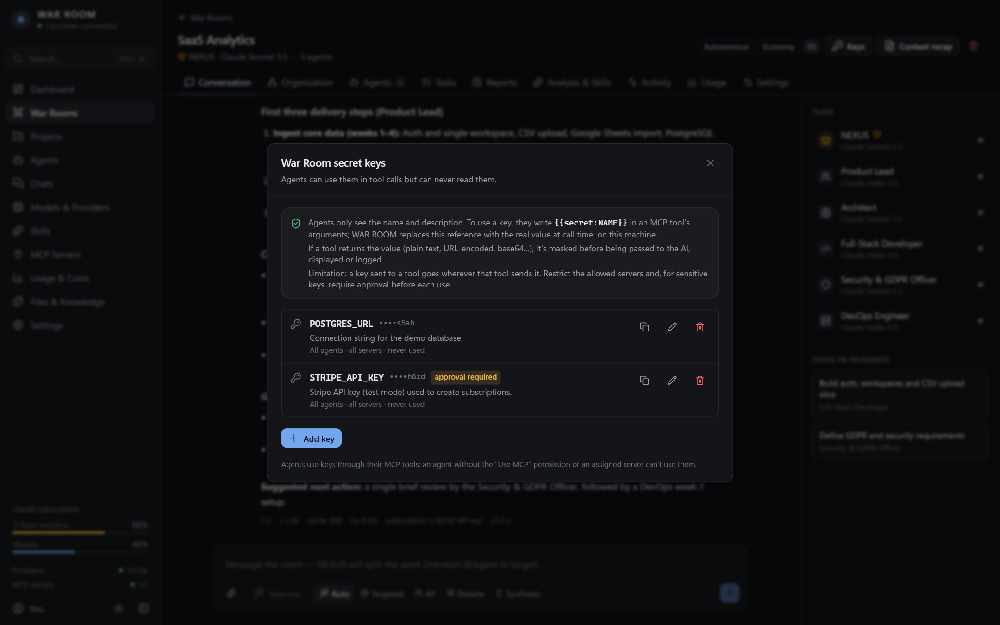</p>

### Usage, down to the token

Calls, input, output and cache tokens, cost actually billed and the equivalent value of your subscription, per model, per agent and per War Room, along with the size of the context sent and your budgets.

<p align="center">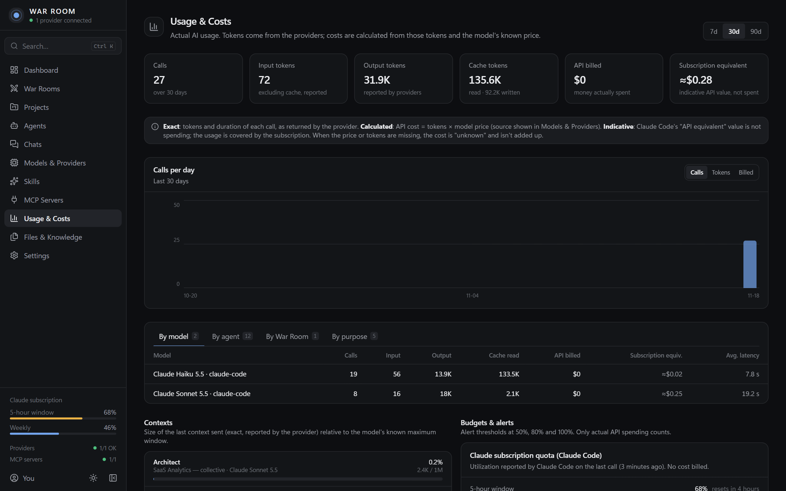</p>

### One dashboard, all providers in one place

<p align="center">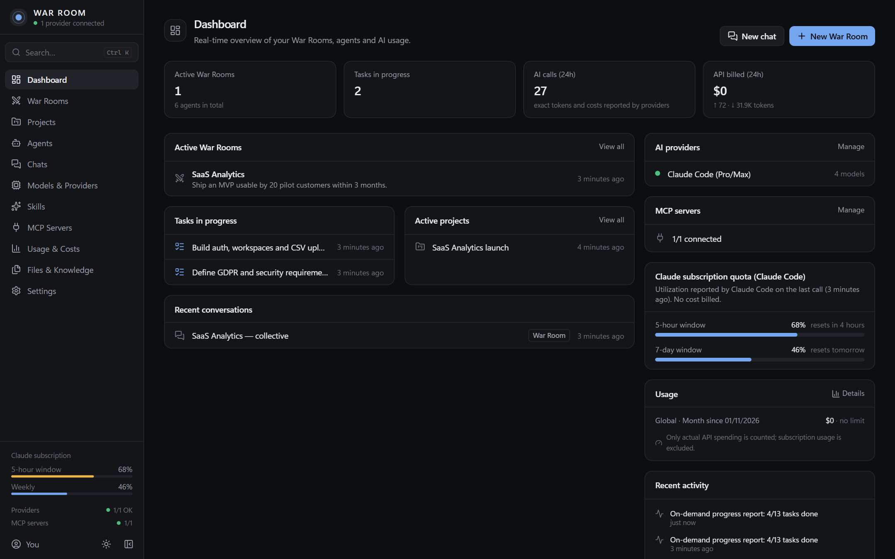 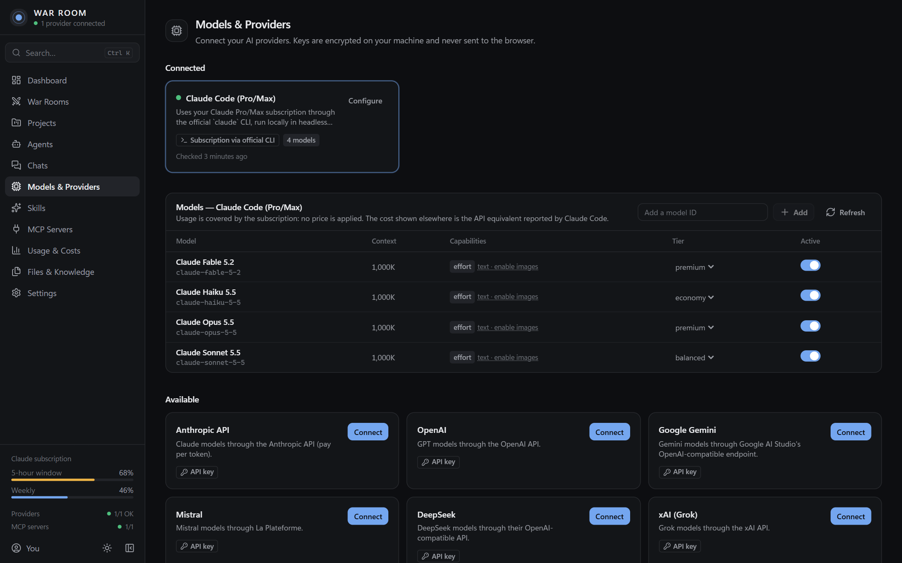</p>

---

## Features

| Area | What you get |
|---|---|
| **War Rooms** | One workspace per project: brief, named orchestrator, configurable agents, autonomy level (assisted, semi-autonomous, autonomous), budget, shared memory. |
| **Orchestration** | Smart routing to the agents that matter, parallel execution, synthesis, debate, human approval of plans, safeguards against runaway loops. |
| **Agents** | Role, prompt, model, effort, Skills, MCP tools, individual memory, budget, fine-grained permissions. Direct chat with each agent. |
| **Standalone chats** | Conversations outside War Rooms with any model, switching models mid-conversation, attachments, search. |
| **Providers** | Claude Code (subscription), Anthropic, OpenAI, Gemini, Mistral, DeepSeek, xAI, OpenRouter, Ollama, any OpenAI-compatible server. |
| **Costs** | Exact tokens per call, labeled costs, budgets with alerts, prompt caching, automatic history summarization, and an "Improve" button that rewrites your message with a low-cost model. |
| **Claude limits** | Tracking of the 5-hour and weekly windows, prediction, clean pause, resume after reset, detailed report. |
| **MCP tools** | STDIO and HTTP servers, per-agent tool selection, sensitive tools gated behind your approval, secret keys injected without exposure. |
| **Skills** | Inventory of your Claude Code Skills, installation into WAR ROOM, assignment to agents, recommendations based on the brief. |
| **Knowledge** | Files (PDF, Word, text, code, CSV) with text extraction, structured memory, context recap, daily reports. |
| **Projects** | Grouping of War Rooms, summary, kanban, list and timeline views, decisions. |
| **Languages** | English and French interface, switchable at any time; generated reports and recaps follow the same language. |

A detailed, up-to-date account of what is implemented and what is not yet is kept in [docs/STATUS.md](docs/STATUS.md).

---

## Quick start

Requirements: Node.js 22 or later (tested with Node 26) and npm.

```bash
npm install
```

```bash
npm run dev
```

Then open http://127.0.0.1:5317. The API runs on port 4317; the database and files are created automatically in `data/`.

For daily use on a single port:

```bash
npm run build
```

```bash
npm start
```

then open http://127.0.0.1:4317.

Other useful commands: `npm test` (unit tests), `npm run typecheck`, `npm run db:generate` (new migration after changing `server/db/schema.ts`).

### First steps

1. **Connect a provider** in Models & Providers. For your Claude subscription, install Claude Code and sign in once (`claude`, then `/login`).
2. **Create a War Room**: describe the project, name your orchestrator, choose the autonomy level and cost strategy.
3. **Let the orchestrator analyze the brief**, then approve the proposed team and tasks.
4. **Write to the War Room** and follow the work: conversation, organization, tasks, reports, usage.

---

## Connecting your AIs

| Provider | Access | Notes |
|---|---|---|
| **Claude Code (Pro/Max subscription)** | Official `claude` command in non-interactive mode | Uses your subscription; Claude Code must be installed and signed in. |
| Anthropic API | API key | Billed per token, separate from the Claude subscription. |
| OpenAI, Gemini, Mistral, DeepSeek, xAI, OpenRouter | API key | OpenAI-compatible endpoints; models are discovered automatically. |
| Ollama | Local, no key | Free and offline. |
| Custom | URL and optional key | LM Studio, vLLM, LiteLLM… |

What each subscription actually allows, and what it does not, is explained in [docs/PROVIDERS.md](docs/PROVIDERS.md).

---

## Security and privacy

- The application is local: the API only listens on `127.0.0.1` and rejects requests coming from other websites.
- API keys and secret keys are encrypted (AES-256-GCM) and never sent back to the browser.
- With the Claude subscription, Claude Code's built-in tools are disabled and every call runs in an empty folder.
- Imported documents and tool results are treated as data, never as instructions.
- No code produced by an agent is executed without control; sensitive tools ask for your approval.

---

## Tech stack

TypeScript end to end: React 19 interface (Vite, Tailwind CSS, Radix), Hono server on Node.js, SQLite database (libSQL and Drizzle), official Anthropic, OpenAI and Model Context Protocol SDKs, streaming over Server-Sent Events.

The architecture choices are explained in [docs/ARCHITECTURE.md](docs/ARCHITECTURE.md).

## Documentation

- [docs/ARCHITECTURE.md](docs/ARCHITECTURE.md): architecture, decisions, modules, security.
- [docs/PROVIDERS.md](docs/PROVIDERS.md): providers, subscriptions and APIs.
- [docs/STATUS.md](docs/STATUS.md): detailed project status.
